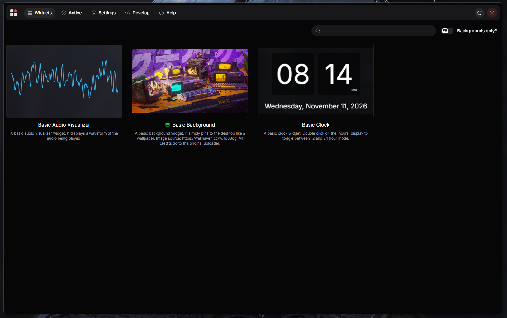
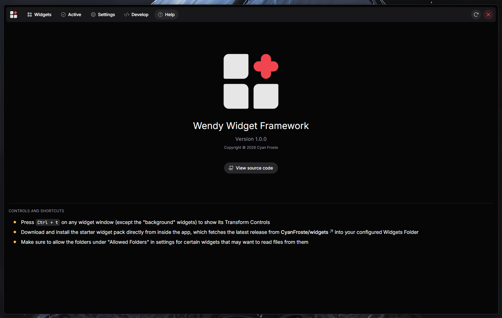

<div align="center">


<br>

# Wendy Widget Framework

A widget framework for **Windows** and **HTML Programmers**.

[](https://github.com/CyanFroste/wendy/releases)
[](https://github.com/CyanFroste/wendy/releases/latest)
[](https://github.com/CyanFroste/wendy/blob/main/LICENSE)

</div>

## Download

- **Recommended:** Download and install using the latest installer from [GitHub Releases](https://github.com/CyanFroste/wendy/releases/latest)
- **Basic Widgets:** Download and install the starter widget pack directly from inside the app, which fetches the latest release from [CyanFroste/widgets](https://github.com/CyanFroste/widgets) into your configured **Widgets Folder** (skipping any widget folders that already exist).

### [Screenshots](./screenshots/index.md)





## About

A desktop widget runtime and manager that runs self-contained web widgets (HTML, CSS, and JavaScript) directly on the desktop.

- **Widget Gallery & Instance Management:** Browse installed widgets in the **Widgets** view, download starter widgets in-app from [CyanFroste/widgets](https://github.com/CyanFroste/widgets), and launch multiple independent instances of any widget.

- **Interactive Desktop Overlays:** Active widgets render on the desktop where they can be dragged, resized via corner/edge handles, locked in place, reconfigured via their editor, or removed, with live instance counts tracked in the **Active** tab. **Press** `Ctrl + t` on any widget window _(except the background widgets)_ to show its **Transform Controls**.

- **Permission & Path Sandboxing:**
  - Each widget declares required capabilities (`permissions`), allowed HTTP hosts (`allowedDomains`), and storage namespaces (`allowedStores`) in `manifest.json`.

  - Filesystem access is restricted to the widget's own `assets/` bundle and user-approved directories explicitly configured under **Allowed Folders** in **Settings**.

- **Zero-Build Widget Authoring:** Widgets load directly from subfolders inside the configured **Widgets Folder** (e.g., `F:\widgets`) without a bundler or compile step, using `base.jsconfig.json`, per-folder `jsconfig.json` files, and ambient `.d.ts` declarations (`common.d.ts`, `content.d.ts`, `editor.d.ts`) for editor IntelliSense.

## Widget Lifecycle & Flow

### Discovery & Creation Flow

1. **Directory Registration:** The host scans the **Widgets Folder** configured in **Settings**. Each valid `<widget-id>/` subdirectory must contain a `manifest.json` and a `content/index.html` entry point, alongside an optional `preview.png` thumbnail displayed in the gallery.

2. **Instance Setup:** Selecting a widget opens its detail view displaying its preview, version, description, and an expandable **Show more details** section.

3. **Instantiation:** If the widget includes an `editor/` directory, the host mounts `editor/index.html` in creation mode (`CREATE NEW INSTANCE`) with `window.widgetInstanceData` initialized to `null`. Clicking **+ Create** commits the initial configuration, assigns a unique instance UUID, and spawns the widget window.

### Directory structure

```sh
<widget-id>/
├── assets/
│   └── widget.png          # Static media and icons used by the widget
├── content/                # Main widget view rendered on the widget window
│   ├── index.html          # Markup entry point for the widget view
│   ├── jsconfig.json
│   ├── script.js           # Widget logic and state, exposes host bridge
│   └── styles.css          # Stylesheet for the widget view
├── editor/                 # Settings/configuration UI for customizing the widget
│   ├── index.html          # Markup entry point for the widget editor
│   ├── jsconfig.json
│   ├── script.js           # Settings form logic
│   └── styles.css          # Stylesheet for the editor view
├── types/                  # Ambient TypeScript declarations (editor IntelliSense only)
│   ├── content.d.ts        # APIs and message types exclusive to content/
│   ├── editor.d.ts         # APIs and message types exclusive to editor/
│   └── common.d.ts         # Common types used by both views
├── base.jsconfig.json      # Shared compiler options extended by subfolder jsconfigs
├── manifest.json           # Widget metadata, permissions, etc.
├── preview.png             # Thumbnail shown in the widget gallery/picker
└── README.md               # Setup instructions and widget documentation
```

### Editor Flow (`editor/`)

The editor provides a sandboxed settings UI used both when creating a new instance and when editing an active one:

1. **Initialization:** When `editor/index.html` loads (either in `CREATE NEW INSTANCE` mode or after clicking the edit icon on an active desktop widget to enter `UPDATE INSTANCE` mode), the host injects `window.widgetInstanceData` containing the instance's saved configuration (or `null` for a new instance).

2. **Configuration & Local Browsing:** `editor/script.js` populates form inputs from `window.widgetInstanceData` and can inspect local files, installed apps, or bundled assets via `window.widgetEditorApi`.
3. **Save Handshake (`onRequestData` → `sendData`):**
   - `editor/script.js` registers a listener with `window.widgetEditorApi.onRequestData(callback)`.

   - When the user clicks **+ Create** or **Update**, the host invokes that callback.

   - Inside the callback, the editor serializes its current form state and calls `window.widgetEditorApi.sendData(payload)` to pass the configuration back to the host.

### Content Flow (`content/`)

1. **Runtime Mounting:** The host creates a desktop overlay window (or background layer if `isBackground` is `true`) and loads `content/index.html`.

2. **Context Injection:** The host exposes two globals on `window`:
   - `window.widgetMeta` — Parsed metadata and manifest declarations (`Widget`).
   - `window.widgetInstanceData` — The configuration object submitted by `editor/` for that specific instance (or `null` if none was configured).

3. **Execution & Live Updates:** `content/script.js` renders the widget UI, communicates with OS services and storage through `window.widgetApi` (enforced against `manifest.json` permissions), and updates whenever new instance data is saved from the editor.

## Permissions Reference

Declare required permissions in `manifest.json` under `"permissions"`:

| Permission Key | Grants Access To                                                                            |
| -------------- | ------------------------------------------------------------------------------------------- |
| `network:exec` | Outbound HTTP requests via `widgetApi.network.request` (restricted to `allowedDomains`)     |
| `system:read`  | Reading approved folders/files, installed apps, CPU/RAM/disk metrics, and Recycle Bin count |
| `system:exec`  | Launching installed applications and opening the Recycle Bin                                |
| `media:read`   | Reading active OS media session metadata, thumbnails, and playback updates                  |
| `media:exec`   | Sending playback controls (`play`, `pause`, `toggle`, `next`, `prev`, `seek`)               |
| `audio:read`   | Reading system master volume/mute state and capturing live audio PCM frames                 |
| `audio:exec`   | Changing system master volume and toggling mute                                             |
| `store:read`   | Reading entries, keys, and values from namespaces listed in `allowedStores`                 |
| `store:write`  | Writing, removing, and clearing entries in namespaces listed in `allowedStores`             |

## API Reference

### Global Context (`window`)

#### `widgetMeta: Widget`

- Read-only manifest metadata for the running widget.

- available in `content/`

- **Permissions needed:** None

#### `widgetInstanceData?: unknown | null`

- Per-instance configuration payload persisted from the widget editor, or `null` if no data has been saved yet.

- available in `content/` and `editor/`

- **Permissions needed:** None

---

### Content API (`window.widgetApi`)

#### `network.request(url: string, options?: HttpOptions) => Promise<HttpResponse>`

- Executes an HTTP request through the host runtime, bypassing WebView CORS limits. `url` must match a domain declared in `allowedDomains` in `manifest.json`.

- **Permissions needed:** `network:exec`

---

#### `audio.getMasterVolume() => Promise<Volume>`

- Returns the current system master output volume level and mute status.

- **Permissions needed:** `audio:read`

#### `audio.setMasterVolume(level: number) => Promise<Volume>`

- Sets the system master output volume to `level` and returns the updated volume state.

- **Permissions needed:** `audio:exec`

#### `audio.toggleMasterMute() => Promise<Volume>`

- Toggles the system master audio mute state and returns the updated volume state.

- **Permissions needed:** `audio:exec`

#### `audio.onAudioCaptured(callback: (data: Float32Array) => void) => void`

- Registers a listener that receives real-time system audio PCM sample frames as a `Float32Array`.

- **Permissions needed:** `audio:read`

---

#### `media.getActiveMedia() => Promise<MediaSessionInfo | null>`

- Retrieves track metadata, album art bytes, supported transport controls, and timeline progress for the active OS media session, or `null` if nothing is playing.

- **Permissions needed:** `media:read`

#### `media.sendCommand(playerId: string, command: MediaCommand) => Promise<void>`

- Dispatches a playback control or timeline seek action to the media player identified by `playerId`.

- **Permissions needed:** `media:exec`

#### `media.onMediaUpdated(callback: (data: MediaSessionInfo) => void) => void`

- Subscribes to push updates whenever the active media session's track info, playback state, or timeline changes.

- **Permissions needed:** `media:read`

---

#### `system.readDir(path: string) => Promise<FileEntry[]>`

- Lists immediate files and subdirectories inside `path`. Scoped strictly to directories added under **Allowed Folders** in app settings.

- **Permissions needed:** `system:read`

#### `system.readFile(path: string) => Promise<Uint8Array>`

- Reads the binary contents of the file at `path`. Scoped strictly to directories added under **Allowed Folders** in app settings.

- **Permissions needed:** `system:read`

#### `system.getFileUrl(path: string) => Promise<string>`

- Resolves a local file path inside an **Allowed Folder** into an asset URL usable directly in ``, `<video>`, `<audio>`, or CSS `url()`.

- **Permissions needed:** `system:read`

#### `system.getInstalledApps() => Promise<InstalledApp[]>`

- Returns discovered installed applications along with their executable/shortcut paths and optional base64 icons.

- **Permissions needed:** `system:read`

#### `system.getCpuInfo() => Promise<CpuInfo>`

- Returns CPU model branding, aggregate usage percentage, logical core count, and per-core usage percentages.

- **Permissions needed:** `system:read`

#### `system.getRamInfo() => Promise<RamInfo>`

- Returns physical memory and swap capacity, usage, and available space in bytes.

- **Permissions needed:** `system:read`

#### `system.getDiskInfo() => Promise<DiskInfo[]>`

- Returns mounted storage drives with mount paths, filesystem types, total/available byte counts, and removable flags.

- **Permissions needed:** `system:read`

#### `system.openInstalledApp(path: string) => Promise<void>`

- Launches an installed application located at `path`.

- **Permissions needed:** `system:exec`

#### `system.openRecycleBin() => Promise<void>`

- Opens the OS Recycle Bin window.

- **Permissions needed:** `system:exec`

#### `system.getRecycleBinCount() => Promise<number>`

- Returns the total number of items currently in the OS Recycle Bin.

- **Permissions needed:** `system:read`

---

#### `store.getStore<T unknown>(name: string) => Store<T>`

- Opens a persistent key-value store bound to `name`. The store name must be listed in `allowedStores` in `manifest.json` (allowing either isolated widget storage or shared cross-widget stores).

#### `Store<T>.entries() => Promise<[string, T][]>`

- Returns all `[key, value]` pairs in the store.

- **Permissions needed:** `store:read`

#### `Store<T>.keys() => Promise<string[]>`

- Returns all keys in the store.

- **Permissions needed:** `store:read`

#### `Store<T>.values() => Promise<T[]>`

- Returns all values in the store.

- **Permissions needed:** `store:read`

#### `Store<T>.get(key: string) => Promise<T | null>`

- Retrieves the value stored under `key`, or `null` if not found.

- **Permissions needed:** `store:read`

#### `Store<T>.set(key: string, value: T) => Promise<void>`

- Saves a JSON-serializable `value` under `key`.

- **Permissions needed:** `store:write`

#### `Store<T>.remove(key: string) => Promise<T | null>`

- Deletes `key` and returns its previous value, or `null` if absent.

- **Permissions needed:** `store:write`

#### `Store<T>.clear() => Promise<void>`

- Removes all entries from the store.

- **Permissions needed:** `store:write`

---

#### `utils.getAssetUrl(path: string) => Promise<string>`

- Converts a relative path inside the widget's own `assets/` folder into a loadable asset URL.

- **Permissions needed:** None

#### `utils.getAsset(path: string) => Promise<Uint8Array>`

- Reads a file from the widget's own `assets/` folder as raw bytes (`Uint8Array`).

- **Permissions needed:** None

#### `utils.openExternalUrl(url: string) => Promise<void>`

- Opens `url` in the system's default external browser.

- **Permissions needed:** None

#### `utils.formatBytes(value: number, options: FormatBytesOptions) => Promise<string>`

- Formats a byte size into a human-readable string (e.g., `"4.2 GB"` or `"3.91 GiB"`).

- **Permissions needed:** None

---

### Editor API (`window.widgetEditorApi`)

#### `system.readDir(path: string) => Promise<FileEntry[]>`

- Lists files and subdirectories inside `path`. Scoped strictly to directories added under **Allowed Folders** in app settings.

- **Permissions needed:** `system:read`

#### `system.readFile(path: string) => Promise<Uint8Array>`

- Reads the binary contents of a file at `path`. Scoped strictly to directories added under **Allowed Folders** in app settings.

- **Permissions needed:** `system:read`

#### `system.getFileUrl(path: string) => Promise<string>`

- Converts a local file path inside an **Allowed Folder** into an asset URL for previewing inside the editor UI.

- **Permissions needed:** `system:read`

#### `system.getInstalledApps() => Promise<InstalledApp[]>`

- Enumerates installed applications on the system for app-picker settings controls.

- **Permissions needed:** `system:read`

---

#### `utils.getAssetUrl(path: string) => Promise<string>`

- Resolves a relative path inside the widget's own `assets/` folder into a loadable asset URL.

- **Permissions needed:** None

#### `utils.getAsset(path: string) => Promise<Uint8Array>`

- Reads a file inside the widget's own `assets/` folder as a `Uint8Array`.

- **Permissions needed:** None

---

#### `onRequestData(callback: () => void) => void`

- Registers a callback triggered by the host when the user clicks **+ Create** or **Update**, signaling the editor to serialize its current state and call `sendData`.

- **Permissions needed:** None

#### `sendData<T>(payload: T) => void`

- Sends the serialized instance configuration `payload` back to the host to create or update the widget instance.

- **Permissions needed:** None

---

### Types

```ts
interface Widget {
  id: string
  name: string
  path: string
  description: string
  version: string
  previewPath?: string | null
  isBackground?: boolean | null
  permissions: string[]
  allowedDomains: string[]
  allowedStores: string[]
  author: string
  source?: string | null
  tags: string[]
}
```

```ts
interface CpuInfo {
  brand: string
  globalUsage: number
  coreCount: number
  coreUsages: number[]
}
```

```ts
interface RamInfo {
  totalBytes: number
  usedBytes: number
  availableBytes: number
  swapTotalBytes: number
  swapUsedBytes: number
}
```

```ts
interface DiskInfo {
  name: string
  mountPoint: string
  fileSystem: string
  totalBytes: number
  availableBytes: number
  isRemovable: boolean
}
```

```ts
interface MediaTimeline {
  startMs: number
  endMs: number
  positionMs: number
  canSeek: boolean
}
```

```ts
interface MediaControls {
  canPlay: boolean
  canPause: boolean
  canToggle: boolean
  canNext: boolean
  canPrev: boolean
}
```

```ts
interface MediaSessionInfo {
  playerId: string
  playerName: string
  title: string
  artist: string
  album: string
  isPlaying: boolean
  isCurrent: boolean
  thumbnail: Uint8Array
  controls: MediaControls
  timeline?: MediaTimeline | null
}
```

```ts
type MediaCommand =
  | { type: 'play' }
  | { type: 'pause' }
  | { type: 'toggle' }
  | { type: 'next' }
  | { type: 'prev' }
  | { type: 'seek'; positionMs: number }
```

```ts
interface HttpResponse {
  status: number
  ok: boolean
  url: string
  headers: Record<string, string>
  body: string
}
```

```ts
interface HttpOptions {
  method?: string | null
  headers?: Record<string, string> | null
  body?: string | null
  timeout_ms?: number | null
}
```

```ts
interface Volume {
  level: number
  muted: boolean
}
```

```ts
interface InstalledApp {
  name: string
  path: string
  iconBase64?: string | null
}
```

```ts
interface FileEntry {
  path: string
  isDir: boolean
}
```

```ts
interface FormatBytesOptions {
  readonly signed?: boolean
  readonly locale?: boolean | string | readonly string[]
  readonly bits?: boolean
  readonly binary?: boolean
  readonly minimumFractionDigits?: number
  readonly maximumFractionDigits?: number
  readonly space?: boolean
  readonly nonBreakingSpace?: boolean
  readonly fixedWidth?: number
}
```

## [License](./LICENSE)

**Wendy Widget Framework** is licensed under the **GNU General Public License v3.0 (GPLv3)**. See the [LICENSE](./LICENSE) file for the full terms. Any modified versions or forks of the host runtime must also be distributed under GPLv3.

**Widget authors are free to use any license they choose** (such as MIT, Apache-2.0, CC0, GPL, or proprietary/commercial licenses) for the widgets they create.

Widgets run in isolated web views and interact with the host solely through the public `window.widgetApi` and `window.widgetEditorApi` interfaces. Creating, distributing, or selling a widget for Wendy Widget Framework does not make that widget a derivative work of the host application under GPLv3.

The TypeScript declaration files (`types/*.d.ts`) and starter widget templates in this repository are additionally dual-licensed under the **MIT License** (or **CC0 1.0 Universal**), allowing widget developers to copy, modify, and bundle them freely inside any widget regardless of its license.

### Attributions

- <a href="https://www.flaticon.com/free-icons/widget" title="widget icons">Widget icons created by Creatype - Flaticon</a>
